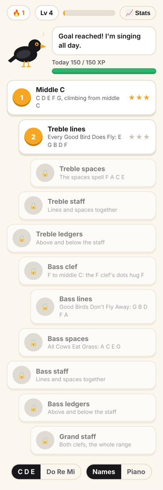
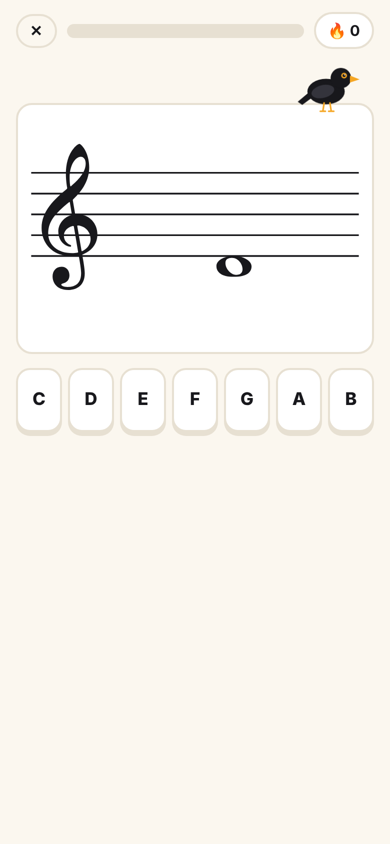
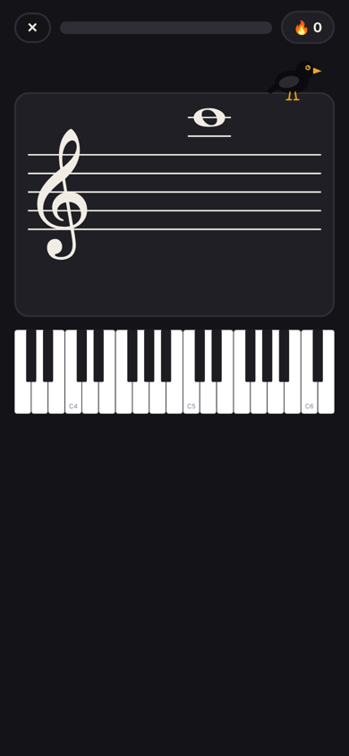
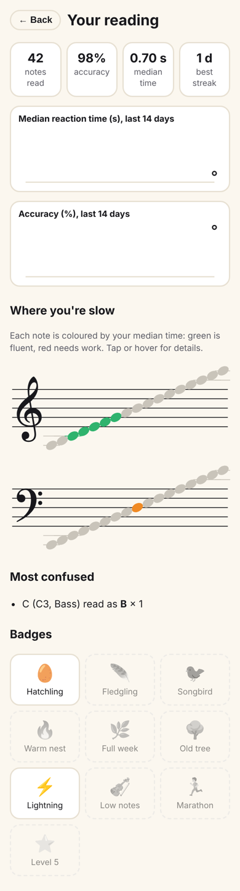

# Merlo 🐦‍⬛

**Learn to read music, one note at a time.** Merlo the blackbird shows you a note on the staff; you name it or play it. He measures how fast and how accurately you read each note, keeps bringing back the notes you're slow on, and celebrates your streaks.

Written in Rust with [Dioxus](https://dioxuslabs.com): one codebase for web, desktop (Windows, macOS, Linux) and mobile. Works fully offline.

<p>
  
  
  
  
</p>

## What's in v0.1

- **11 lessons** from middle C to the grand staff: treble and bass lines, spaces and ledger lines, unlocked one after the other.
- **Two ways to answer:** seven name buttons (C D E… or Do Re Mi), or an on-screen piano where the octave counts. You can also type the letter keys on a keyboard.
- **Adaptive drills:** notes you miss or read slowly come up more often.
- **Accurate stats:** median reaction time per note (a heatmap on the staff), accuracy, daily trends over 14 days, and the notes you confuse most.
- **Game layer:** XP with a speed bonus, levels, a daily goal, a day streak, 0–3 stars per lesson and 10 badges.
- **Light and dark themes**, honours reduced motion.

## Run it

```sh
cargo install dioxus-cli@0.7.10 --locked
rustup target add wasm32-unknown-unknown

dx serve -p merlo --platform web        # http://localhost:8080
dx serve -p merlo --platform desktop    # Windows needs WebView2 (built into Windows 10/11)
dx serve -p merlo --platform android    # needs the Android SDK + NDK
dx bundle -p merlo --platform web --release   # static site; dx prints the output folder
```

Progress is saved in `localStorage` on the web, and in your data folder (`%APPDATA%\merlo\merlo.json` on Windows) on desktop. If a save file can't be read, it is backed up rather than overwritten.

## Develop

```sh
cargo test --workspace                                     # 64 tests
cargo llvm-cov --workspace --fail-under-lines 80           # coverage gate (CI enforces it)
cargo clippy --workspace --all-targets                     # pedantic, warnings are errors in CI
MERLO_SNAPSHOTS=out cargo test -p merlo snapshots          # every screen as static HTML for visual review
```

### Architecture

```
crates/
  core/   merlo-core: pure domain logic, no IO. ~99% covered.
    pitch.rs       Letter, Accidental, Pitch (C4 = middle C), Midi keys
    staff.rs       Clef, StaffPos (0 = bottom line), Card = pitch in a clef
    drill.rs       Guess, Attempt, Drill state machine (Asking → Feedback → Done), adaptive picker
    stats.rs       Tally, group_by, confusions, XP, streaks, levels, Profile
    curriculum.rs  Lessons as spans of staff positions; stars and unlocking
    badge.rs       Badges as predicates over the Profile
  app/    merlo: a thin Dioxus UI over the core
    geometry.rs    pure layout math (staff, keyboard, charts, heat colours)
    glyphs.rs      Bravura clef and notehead outlines as SVG paths
    components.rs  Staff, Piano, NamePad, Mascot, …
    screens.rs     Home, Drill, Summary, Stats
    store.rs       persistence; platform.rs: clock, seed, timers
```

**One source of truth.** The only thing ever stored is an append-only log of `Attempt`s (when, which note, what you answered, how long you took). Every number on screen (streaks, XP, stars, badges, heatmaps) is a pure fold over that log, so new stats need no data migration, and cloud sync will just mean syncing the log.

**Illegal states are unrepresentable.** `Phase` makes answering outside a question impossible, and feedback always carries its attempt. `StaffPos` is derived from `Pitch` and `Clef`, never stored. Times are `Timestamp`, `Millis` and `Day` newtypes.

## Roadmap

1. **MIDI keyboard input** (Web MIDI and desktop), with sound.
2. Accidentals and key signatures; intervals and chords; rhythm reading.
3. Android/iOS builds and app-store polish.
4. Accounts and cloud sync of the attempt log; friends, leagues and missions.

## Credits & license

Code: [MIT](LICENSE) © 2026 Luca Rossi.

Music glyphs (clefs, noteheads) are outlines from the [Bravura](https://github.com/steinbergmedia/bravura) font © Steinberg Media Technologies GmbH, under the [SIL Open Font License 1.1](https://openfontlicense.org), via VexFlow's glyph tables.
